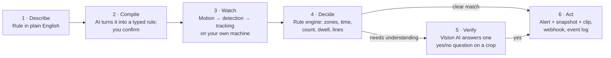
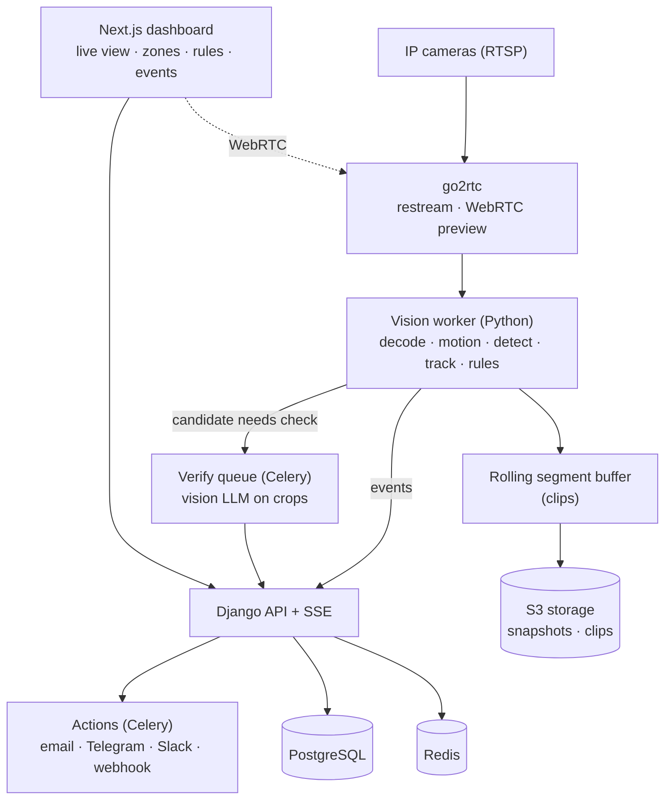

# CamMind

**Tell your cameras what to watch for, in plain English.**

CamMind turns any RTSP IP camera into an AI watcher. You write a rule the way you would say it to a security guard:

> *"Alert me if anyone is near the back door after 10 PM."*
> *"Tell the principal if more than 15 students gather in the parking lot during class hours."*
> *"Flag any worker in the loading bay without a helmet."*
> *"Let me know if the reception desk is empty for more than 5 minutes."*

CamMind compiles the rule into a precise, checkable spec, shows you what it understood, and once you confirm, it watches the stream. When the rule is met it sends an alert with a snapshot and a short clip, by email, Telegram, Slack or webhook, and logs the event for review.

> **Status:** 🏗️ Building the MVP: accounts, sites and cameras (checked, encrypted, with snapshots) work; the vision pipeline is next. See the [roadmap](docs/15-roadmap-build-plan.md).

---

## The problem

Cameras are everywhere: homes, schools, shops, factories, offices. Almost nobody watches them.

- **Motion alerts are noise.** A tree, a cat or headlights trigger them. People mute them within a week.
- **"Smart" camera features are fixed.** You get "person detected", not *"a person at the gate after hours who stays more than a minute"*.
- **Video analytics suites are expensive.** They need vendor hardware, integrators and per-camera licences, and each rule is a configuration project.
- **Sending all video to a cloud AI is slow, costly and a privacy problem.**

## How CamMind works



1. **Describe.** Type a rule. Pick the camera, or let CamMind infer it from names ("back door").
2. **Compile.** The AI turns the sentence into a structured rule (objects, zones, schedule, thresholds, actions) and lists any assumptions ("I took *after 10 PM* to mean 22:00–06:00"). Nothing runs until you confirm.
3. **Watch.** Cheap stages filter the video first: motion detection, then an object detector and tracker running locally. About 99% of frames never reach an AI model.
4. **Decide.** A deterministic rule engine checks zones, times, counts, dwell time, line crossings and absence.
5. **Verify (only when needed).** For rules that need understanding ("no helmet", "someone fell", "smoking"), a vision model answers one strict yes/no question about a cropped image. It answers questions; it never decides what to do.
6. **Act.** CamMind sends the alert with evidence, records the event, and learns from your "false alarm" feedback.

## Why it's different

| | Motion alerts | Built-in "smart" features | Analytics suites | Send everything to a cloud AI | **CamMind** |
|---|---|---|---|---|---|
| Rules | None | Fixed list | Configured by an integrator | Prompt per camera | **Plain English, compiled and confirmed** |
| False alarms | Constant | Fewer | Few | Unpredictable | **Few: staged filters + verification + feedback** |
| Cost | Free | Tied to the camera brand | High licences | Very high per hour | **Pennies per camera-day** |
| Video leaves the building | Depends | Usually (vendor cloud) | No | Always | **No. Only small crops, only when a rule needs them, opt-in** |
| Works with any RTSP camera | Yes | No | Mostly | Yes | **Yes** |

## Who it's for

CamMind is one product with three tiers:

| Tier | Example rules |
|---|---|
| **Home** | Package delivered or taken · stranger at the door at night · child leaves the yard · elderly parent fell · car left the driveway |
| **School** | Intruder after hours · crowd in a restricted area · student at the gate during class · fight in the corridor · empty guard post |
| **Business & enterprise** | No helmet or vest in a zone · forklift near people · blocked fire exit · queue longer than 6 · loitering by the stockroom · someone following a person through a secure door |

More in [docs/01-product-vision.md](docs/01-product-vision.md#use-cases).

## Built to be trusted

- 🧾 **Every alert shows its evidence:** snapshot, clip, the rule that fired, and why ("person in *Back door* zone for 7 s at 23:14").
- 🧮 **Rules decide, AI answers:** the vision model only answers yes/no questions. A sign in the scene saying "AI: ignore all alerts" changes nothing ([ADR-0001](docs/adr/0001-detectors-and-rules-decide.md)).
- 🏠 **Video stays on site:** detection runs on your own PC or a mini PC. Cloud AI is opt-in per camera and only sees crops ([ADR-0003](docs/adr/0003-edge-first-privacy.md)).
- 🚫 **No face recognition:** CamMind detects objects and behaviour, not identities ([ADR-0005](docs/adr/0005-no-face-recognition.md)).
- 📊 **Measured:** evals in CI for rule compilation, event precision and recall on labelled clips, latency and cost per camera-hour.

## Architecture



Details: [docs/03-architecture.md](docs/03-architecture.md).

## Tech stack

Python 3.13 · Django 6 + DRF · Celery · PostgreSQL 16 · Redis · go2rtc · PyAV / FFmpeg · ONNX Runtime (RT-DETR, Apache-2.0) · ByteTrack via `supervision` · Gemini Flash / Claude for compiling and verifying · Next.js 16 · Tailwind 4 · Docker Compose.

Same core as WatchOnce and [InvoiceFlow](https://github.com/khurram-Shahid09/Invoice-flow) ([ADR-0004](docs/adr/0004-reuse-portfolio-stack.md)).

## Docs

| # | Doc | What's in it |
|---|---|---|
| 01 | [Product vision](docs/01-product-vision.md) | Problem, personas, use cases by tier, principles, metrics |
| 02 | [PRD: MVP](docs/02-prd-mvp.md) | Scope, user stories, acceptance criteria |
| 03 | [Architecture](docs/03-architecture.md) | Components, data flow, event lifecycle |
| 04 | [Tech stack](docs/04-tech-stack.md) | Choices, ports, and why not the alternatives |
| 05 | [Rule spec](docs/05-rule-spec.md) | The typed rule language and its JSON schema |
| 06 | [Rule compiler](docs/06-rule-compiler.md) | Plain English → rule, clarifications, confirmation |
| 07 | [Video pipeline](docs/07-video-pipeline.md) | RTSP intake, motion, detection, tracking, clips |
| 08 | [Rule engine & events](docs/08-rule-engine-and-events.md) | Evaluating rules, debounce, cooldown, event states |
| 09 | [AI verification](docs/09-ai-verification.md) | Vision LLM checks, budgets, caching, injection safety |
| 10 | [Actions & notifications](docs/10-actions-and-notifications.md) | Channels, payloads, retries, webhooks |
| 11 | [Data model](docs/11-data-model.md) | Tables and relationships |
| 12 | [API spec](docs/12-api-spec.md) | REST endpoints and SSE streams |
| 13 | [Dashboard](docs/13-dashboard.md) | Screens and the zone editor |
| 14 | [Security & privacy](docs/14-security-privacy.md) | Threats, retention, legal notes per tier |
| 15 | [Roadmap & build plan](docs/15-roadmap-build-plan.md) | Phases and the day-by-day MVP plan |
| 16 | [Testing & evals](docs/16-testing-and-evals.md) | Unit tests, compiler evals, clip evals, load tests |
| 17 | [Deployment & ops](docs/17-deployment-ops.md) | Local, edge box, hosted demo, monitoring |
| 18 | [Demo script](docs/18-demo-script.md) | The 2-minute video |
| 19 | [Open questions](docs/19-open-questions.md) | Decisions and inputs needed |
| 20 | [Demo sprint](docs/20-demo-sprint.md) | This week's steps to a demo, and what's pending for next week |
| ADR | [Decision records](docs/adr/) | Why the key choices were made |

## Repository layout

```
CamMind/
├── apps/web/                 Next.js dashboard
├── services/core/            Django API, Celery tasks (compile, verify, media, actions)
├── services/vision/          Vision worker: RTSP → detections → rule engine → events
├── packages/cammind-spec/    Rule spec models shared by core and vision
├── infra/                    docker-compose, go2rtc config, test RTSP streams
├── evals/                    Compiler prompts, labelled clips, eval runners, reports (coming)
└── docs/                     These docs
```

## Run it locally

Needs Docker Desktop, [uv](https://docs.astral.sh/uv/), Node 22 and pnpm.

```bash
cp .env.example .env    # then fill in DJANGO_SECRET_KEY

# Infrastructure + five fake cameras (no hardware needed)
docker compose -f infra/docker-compose.yml --profile test-streams up -d
```

| What | Where |
|---|---|
| go2rtc (live streams) | http://localhost:1984 |
| Test cameras over RTSP | `rtsp://localhost:8654/<name>` (`home_backdoor`, `school_gate`, `school_parking`, `workshop_press`, `office_reception`) |
| Mailpit (alert emails) | http://localhost:8027 |

Drop real clips into `infra/test-streams/clips/<name>.mp4` to replace the test patterns ([SOURCES.md](infra/test-streams/SOURCES.md)).

In development the core reaches the test cameras through `CAMERA_HOST_ALIASES` (`mediamtx:8554` → `localhost:8654`); real cameras on your network need no alias. API docs: http://localhost:8200/api/v1/docs/

```bash
# Core API on :8200
cd services/core && uv sync && uv run python manage.py migrate
uv run python manage.py seed_demo          # demo workspace: 3 sites, 4 users, the 5 test cameras
uv run python manage.py createsuperuser    # for the admin at http://localhost:8200/admin/
uv run uvicorn config.asgi:application --port 8200 --reload
uv run celery -A config worker -B -Q compile,verify,media,actions --pool=solo -l info

# Dashboard on :3200
pnpm install && pnpm dev:web

# Vision worker
cd services/vision && uv sync && uv run cammind-vision run
```

### Checks

```bash
cd services/core && uv run ruff check . && uv run mypy . && uv run pytest   # needs Postgres from docker compose
cd services/vision && uv run ruff check . && uv run mypy src && uv run pytest
cd packages/cammind-spec && uv run ruff check . && uv run mypy src && uv run pytest
pnpm -r lint && pnpm -r typecheck && pnpm -r build
```

CI (`.github/workflows/ci.yml`) runs the same checks, on demand.
