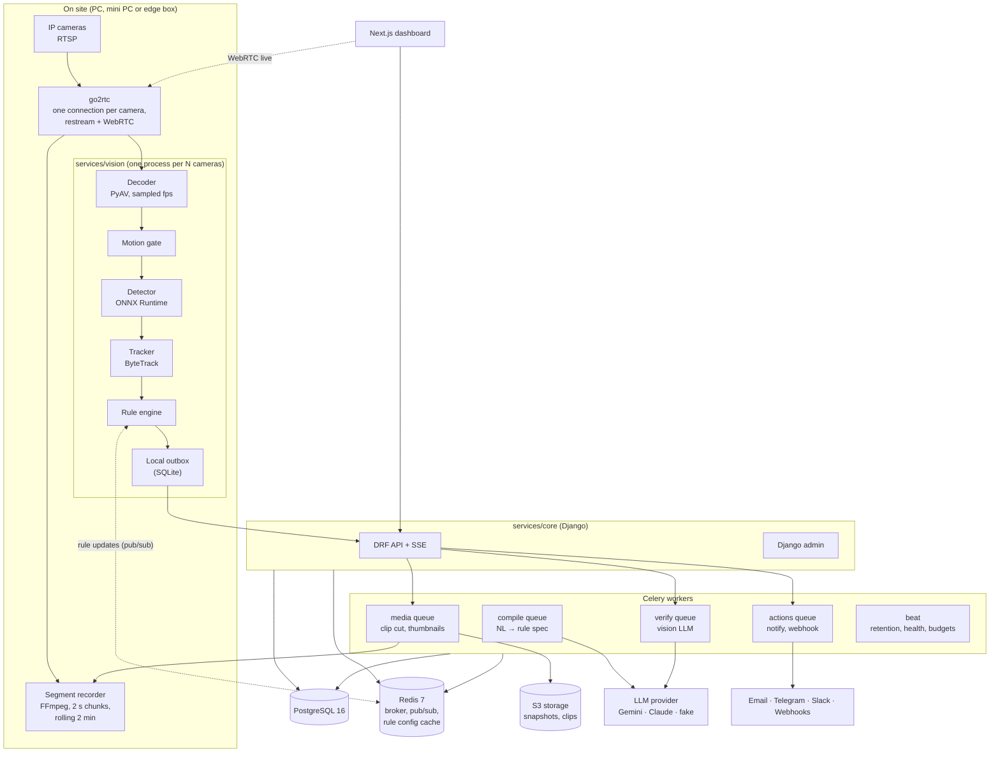
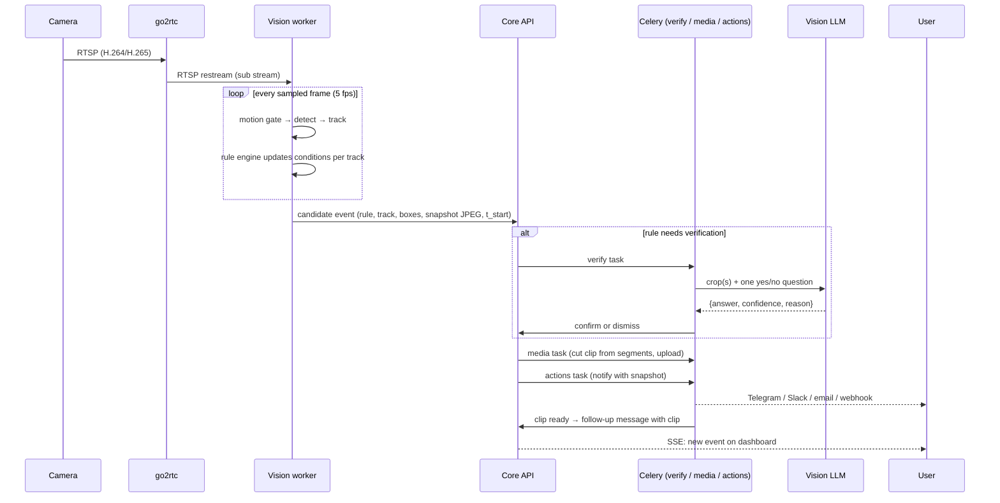
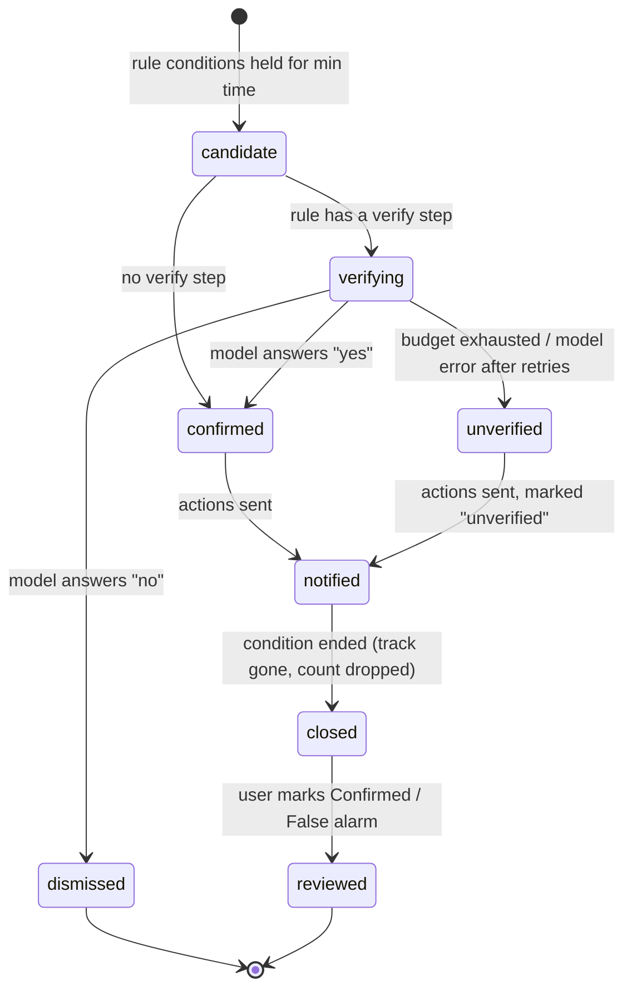

# 03 · Architecture

## Components

## Why the vision worker is not a Celery task

Celery is built for short jobs. A camera stream is a long-running loop that holds a decoder, a tracker state and a frame buffer in memory. So:

- **`services/vision`** is a plain Python process (`python -m cammind_vision run --cameras cam_a,cam_b`). It's supervised by Docker (restart policy) or a small supervisor in dev. One process handles several cameras, with one thread per camera for decoding and a shared detector session that batches frames.
- **Celery** handles everything short and retryable: compiling rules, verification calls, cutting clips, sending notifications, retention.

The vision worker talks to the core over HTTP (`POST /internal/events`, with a worker token) and listens on Redis for rule and camera changes. That boundary is what later allows an edge box at a school to report to a hosted control plane ([17](17-deployment-ops.md#multi-site-v03-designed-now)).

## Data flow: from frame to alert

The snapshot alert is sent **before** the clip is ready, so the user is told within seconds. The clip follows a few seconds later, after the post-event part has been recorded.

## Event lifecycle

- **Dismissed** events are kept (without clips) for tuning and evals, and hidden from the default timeline.
- An event stays **open** while its condition holds, so a person standing at the door for 3 minutes is one event with a duration, not 36 alerts.

## Core modules (`services/core`)

| App | Responsibility |
|---|---|
| `accounts` | Orgs, sites, users, memberships, roles, API tokens |
| `cameras` | Cameras, streams, encrypted credentials, health, go2rtc config sync |
| `zones` | Polygons and lines per camera |
| `rules` | Rule, rule version, compiled spec, validation, test runs |
| `compiler` | NL → spec via the LLM provider; clarifying questions |
| `events` | Event ingest from workers, state machine, feedback, comments |
| `verification` | Verify tasks, prompt templates, caching, budgets |
| `media` | Segment index, clip cutting, thumbnails, S3 upload, retention |
| `actions` | Channels (email, Telegram, Slack, webhook), deliveries, retries |
| `usage` | AI usage ledger and caps |
| `audit` | Append-only audit log (copied pattern from WatchOnce) |
| `common` | Prefixed IDs, org-scoped managers, LLM provider wrapper, SSE helpers |

## Vision worker modules (`services/vision`)

| Module | Responsibility |
|---|---|
| `ingest` | Open RTSP via PyAV, reconnect with backoff, frame sampling, health metrics |
| `motion` | Downscaled frame differencing with a background model; per-zone motion masks |
| `detect` | ONNX Runtime session (CPU / DirectML / CUDA), batching across cameras, class filtering |
| `track` | ByteTrack via `supervision`; stable track IDs, velocity |
| `geometry` | Zone polygons, line crossing with direction, normalised ↔ pixel |
| `engine` | Evaluates compiled rules per frame and per track; debounce, cooldown, schedule |
| `snap` | Draw boxes and zones, encode JPEG, crops for verification |
| `outbox` | SQLite queue of events and heartbeats; retried POSTs to the core |
| `config` | Loads cameras and rules from the core; hot reload on Redis pub/sub |

## Key decisions

| Decision | Record |
|---|---|
| Detectors and rules decide; the LLM answers questions | [ADR-0001](adr/0001-detectors-and-rules-decide.md) |
| Plain English compiles to a typed spec that the user confirms | [ADR-0002](adr/0002-compiled-rules-not-prompts.md) |
| Edge-first processing; cloud AI opt-in, crops only | [ADR-0003](adr/0003-edge-first-privacy.md) |
| Same stack as WatchOnce and InvoiceFlow | [ADR-0004](adr/0004-reuse-portfolio-stack.md) |
| No face recognition | [ADR-0005](adr/0005-no-face-recognition.md) |
| Apache-2.0 detector via ONNX Runtime | [ADR-0006](adr/0006-permissive-detector-onnx.md) |

## Failure handling

| Failure | Behaviour |
|---|---|
| Camera drops | Reconnect with backoff; health → `reconnecting`; after 2 min → system event |
| Core API down | Worker keeps detecting; events go to the SQLite outbox and are sent when it's back (with original timestamps) |
| Redis down | Worker keeps last known rules; config reload resumes when Redis is back |
| LLM timeout / error | Two retries with backoff; then event → `unverified` (alerts still go out, marked) |
| LLM budget reached | Same as above, plus a usage warning to owners |
| Notification channel fails | Retries with backoff for up to 1 hour; delivery marked failed; other channels unaffected |
| Detector too slow (CPU overloaded) | Worker lowers detection fps per camera (5 → 3 → 2) and reports it in health, rather than lagging behind real time |
