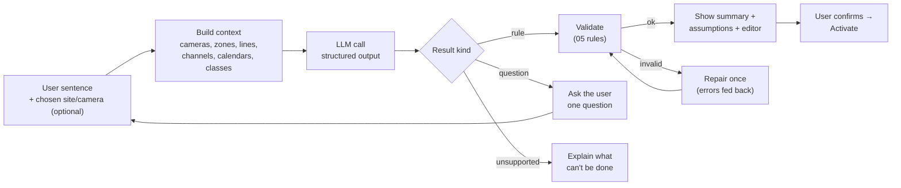

# 06 · Rule Compiler

Turns a sentence into a [rule spec](05-rule-spec.md). It runs only when a user writes or edits a rule, never on the video path, so a few seconds of latency and a few cents are fine.

## Flow



## Context sent to the model

Only names and IDs, never video or credentials:

```json
{
  "site": { "name": "Main campus", "timezone": "Asia/Karachi",
            "calendars": { "school_hours": "Mon–Fri 08:00–14:00", "business_hours": "Mon–Sat 09:00–18:00" } },
  "cameras": [
    { "id": "cam_gate", "name": "Main gate",
      "zones": [{ "id": "zn_guard_post", "name": "Guard post" }],
      "lines": [{ "id": "ln_gate", "name": "Gate line", "in_side": "campus" }] },
    { "id": "cam_parking_1", "name": "Parking lot east", "zones": [{ "id": "zn_parking_1", "name": "Parking" }] }
  ],
  "channels": [{ "id": "ch_principal_telegram", "name": "Principal (Telegram)" }],
  "roles": ["owner", "admin", "operator"],
  "detector_classes": ["person", "car", "truck", "..."],
  "now": "2026-10-30T10:15:00+05:00"
}
```

## Output schema

The model must return exactly one of three kinds (a Pydantic discriminated union, JSON Schema enforced by the provider):

```json
{ "kind": "rule",
  "spec": { "...": "RuleSpec" },
  "summary": "Person in Back door for at least 3 s, every day 22:00–06:00 → Telegram to Owner with clip",
  "assumptions": ["'After 10 PM' read as 22:00–06:00", "'Near' read as inside the zone Back door"],
  "confidence": 0.86 }
```
```json
{ "kind": "question",
  "question": "Which camera shows the back door: 'Backyard' or 'Kitchen side'?",
  "options": ["cam_backyard", "cam_kitchen"],
  "partial_spec": { "...": "fields already understood" } }
```
```json
{ "kind": "unsupported",
  "reason": "CamMind doesn't recognise specific people. I can alert when any person is at the gate.",
  "suggestion": "Alert me if anyone is at the gate after 9 PM" }
```

## Prompt (outline)

System prompt, versioned in `services/core/compiler/prompts/compile_v1.md`:

1. **Role:** "You translate a camera monitoring request into a rule spec. You don't watch video."
2. **The schema** with a short meaning for each field (generated from the Pydantic docstrings).
3. **Mapping guidance:**
   - "someone / anyone / a person / students / workers / kids / intruder" → `person`. Say in the assumptions that the detector can't tell students from staff, or children from adults ("any person going past the gate counts").
   - "near X" → zone X with `bottom_center`; "enters / goes past / crosses" → line if one exists, else zone `enter`.
   - "for more than N minutes", "keeps standing", "loitering" → `dwell`; "empty / unattended / nobody at" → `absence`.
   - "without a helmet / vest / mask", "smoking", "fell", "fighting", "climbing" → `verify` with a visible-only yes/no question; actions → `frame_strip`.
   - Objects not in the class list ("package", "boxes", "spill", "smoke") → `scene` + `verify` on the zone.
   - "at night" → 22:00–06:00; "after hours" → `outside_business_hours` (or `outside_school_hours` for school sites); always add the assumption.
   - No channel mentioned → `notify` to role `owner` with snapshot.
4. **Never invent IDs.** If no matching zone exists, return a `question` offering to create it ("There's no zone called 'back door' on Backyard. Draw one now?").
5. **Refusals** (below) → `unsupported`.
6. **Few-shot examples:** 12 pairs covering every condition type and all three tiers, plus 3 questions and 3 refusals.

User message: the sentence, wrapped in `<request>` tags and marked as data.

## Repair loop

If validation fails (unknown zone, crossing without a line, …), the validation errors are sent back once in a second call: *"Your spec failed these checks: … Return a corrected result."* If it still fails, the user sees the form editor pre-filled with what was understood, plus the errors. Max 2 LLM calls per compile.

## What the user sees

```
┌───────────────────────────────────────────────────────────────┐
│ "Alert me if anyone is near the back door after 10 PM"        │
├───────────────────────────────────────────────────────────────┤
│ When   a [person]  is in [Back door ▾] on [Backyard ▾]        │
│        for at least [3] s                                     │
│ Time   every day [22:00] – [06:00]   (Asia/Karachi)           │
│ Then   notify [Owner ▾] on Telegram · snapshot + 15 s clip    │
│        don't repeat for [2] min                               │
│                                                               │
│ ℹ Assumptions                                                 │
│   • "After 10 PM" read as 22:00–06:00                         │
│   • "Near" read as inside the zone Back door                  │
│                                                               │
│ [Test on last 5 min]  [Show JSON]        [Cancel] [Activate]  │
└───────────────────────────────────────────────────────────────┘
```

Every bracketed field is editable. Editing a field updates the spec directly (no second LLM call). The summary sentence is regenerated deterministically from the spec by a template, not by the LLM, so the summary always matches what will run.

## Refusals

The compiler returns `unsupported` for:

| Request | Why | Offered instead |
|---|---|---|
| Recognising a specific person ("tell me when Ali comes home") | No face recognition ([ADR-0005](adr/0005-no-face-recognition.md)) | "Any person at the gate" |
| Telling people apart by gender, ethnicity, religion or age ("alert if a woman enters", "only men") | Discrimination and privacy risk; the detector can't do it reliably anyway | A behaviour-based rule, if one fits |
| Emotion or intent ("someone looks suspicious", "angry customers") | Not reliable; leads to profiling | A concrete behaviour: loitering (dwell), entering after hours |
| Audio ("if someone screams") | No audio in the MVP | – |
| Controlling devices ("lock the door") | No device control in the MVP. Webhook to the user's own system is allowed | "Send a webhook to your door system" |
| Monitoring areas where people expect privacy (washrooms, changing rooms inside) | Legal and ethical | Entrance-area rules only, with a warning |

## Cost and caching

- One call per compile, at most two. About 2–3k input tokens and 500 output tokens.
- Cached by hash of (sentence, context, prompt version) for 24 h, so "Test → edit → back" doesn't re-bill.
- Uses the cheap model by default; a "Try with the better model" button switches to Claude for hard sentences (logged for evals).

## Evals

See [16 · Compiler evals](16-testing-and-evals.md#compiler-evals): ~80 sentences across home, school and enterprise, including Roman Urdu ("raat ko gate pe koi aaye to batana") and adversarial inputs.
