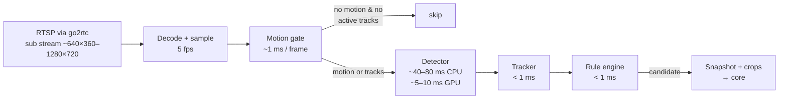

# 07 · Video Pipeline

From RTSP packets to tracked objects, on a normal CPU. The design goal: spend almost nothing on frames where nothing happens.

## Stages and budgets

| Stage | Runs on | Typical cost | Passes on |
|---|---|---|---|
| Decode | every sampled frame | ~3–5 ms (sub stream) | all frames at the sample rate |
| Motion gate | every sampled frame | ~1 ms (160 px greyscale) | frames with motion, or while tracks are alive |
| Detector | gated frames | 40–80 ms CPU at 640 px | detections |
| Tracker + engine | gated frames | < 2 ms | candidate events |
| Vision LLM | candidates that need it | 0.5–3 s, network | yes / no |

On a quiet scene (night yard, empty corridor) the detector runs on a few percent of frames.

## 1 · Intake (`ingest`)

- **go2rtc** holds the only connection to each camera and re-serves it: `rtsp://localhost:8554/<camera_id>` (detection, sub stream), `rtsp://localhost:8554/<camera_id>_hd` (clips, main stream), and WebRTC for the dashboard. The core writes go2rtc's config from the cameras table and reloads it through go2rtc's API.
- **PyAV** opens the restream over TCP (`rtsp_transport=tcp`, timeouts set), decodes, and keeps a frame only when its timestamp passes the next sample tick (default 5 fps; per camera 1–15).
- **Timestamps:** stream PTS is mapped to wall-clock time at connect, and re-synced every minute to absorb drift. All events use wall-clock UTC.
- **Reconnect:** on error or 10 s without frames → close, wait (1, 2, 5, 10, 30, 60 s, then every 60 s), reopen. Health is reported every 10 s: `state`, `decode_fps`, `detect_fps`, `last_frame_at`, `lag_ms`.
- **Codecs:** H.264 and H.265. If a camera sends H.265 and the browser can't play it, go2rtc can transcode the preview only (optional, costs CPU); detection is unaffected.

## 2 · Motion gate (`motion`)

- Downscale to 160 px wide, greyscale, blur.
- Running-average background (`cv2.accumulateWeighted`, α ≈ 0.05); threshold the difference; morphological open; count changed pixels.
- **Per-zone masks:** motion only counts if it's inside the union of the zones used by active rules (plus a margin), or the whole frame for `frame` rules. A swaying tree outside every zone can't wake the detector.
- The gate stays **open** while any track is alive and for 2 s after, so slow-moving or still people keep being tracked.
- `absence` rules force a detection at least every 2 s in their zone even without motion. A person sitting still at a desk must still count as present.
- `scene` rules get a "motion settled" signal: motion in the zone, then 5 s of no motion. That's when a package was just put down or a pallet was just left.
- Night IR switch, headlights and sudden exposure changes: if more than 60% of the frame changes in one tick, the background is reset and no motion is reported for that tick.

## 3 · Detection (`detect`)

- **Model:** RT-DETRv2-S or D-FINE-S (Apache-2.0), COCO-trained, exported to ONNX at 640×640. Chosen in week 1 by a short benchmark on the eval clips (accuracy on small far-away people vs. CPU speed). See [ADR-0006](adr/0006-permissive-detector-onnx.md).
- **Runtime:** ONNX Runtime with the best available provider: CUDA → DirectML → CPU. One session per worker process, shared by all cameras.
- **Batching:** frames from several cameras that arrive within 30 ms are batched (up to 4) to use the CPU/GPU better.
- **Letterbox** to 640 keeping the aspect ratio; boxes mapped back to the original frame.
- **Filtering:** keep only classes used by at least one active rule on that camera; per-rule thresholds are applied later in the engine (the detector uses the lowest one).
- **Overload control:** if the detector can't keep up (queue > 2 frames per camera), detection fps is reduced for the busiest cameras first, down to 2 fps, and reported in health.

## 4 · Tracking (`track`)

- **ByteTrack** through `supervision.ByteTrack`, one tracker per camera.
- Settings tuned for 5 fps: `track_activation_threshold` 0.4, `lost_track_buffer` 25 frames (5 s), `minimum_matching_threshold` 0.8.
- Each track keeps: class, first and last seen, last box, anchor history (for line crossing and speed), zones entered and when, aspect-ratio history (for fall triggers).
- Track IDs are local to a camera and a worker run. They're not identities and are never linked across cameras ([ADR-0005](adr/0005-no-face-recognition.md)).

## 5 · Geometry (`geometry`)

- Zones and lines are stored normalised (0–1) and converted to pixels for each stream resolution.
- **In zone:** the anchor point (default bottom centre of the box) is inside the polygon (`supervision.PolygonZone` / point-in-polygon).
- **Line crossing:** the anchor moved from one side of the line to the other between consecutive positions, with a 3-frame confirmation to ignore jitter on the line. Direction is decided from the line's "in" side.

## 6 · Clips (`SEG` recorder + `media`)

- One FFmpeg process per camera copies the **main** stream from go2rtc into 2-second MPEG-TS segments without re-encoding: `ffmpeg -rtsp_transport tcp -i rtsp://localhost:8554/<cam>_hd -c copy -f segment -segment_time 2 -reset_timestamps 1 -strftime 1 buf/<cam>/%s.ts`.
- A rolling buffer keeps the last 2 minutes (about 60 files); older files are deleted by the recorder supervisor.
- When an event confirms, a `media` task waits until `t_start + clip_post_seconds` is covered, concatenates the matching segments, trims with FFmpeg (stream copy where possible, re-encode only to cut at non-keyframes if needed), remuxes to MP4 (`+faststart`), creates a poster JPEG, and uploads to S3.
- Disk use: ~1–2 Mbps main stream → ~15–30 MB per camera for the 2-minute buffer.
- If the main stream isn't available, clips come from the sub stream.

## 7 · Snapshots and crops (`snap`)

- **Alert snapshot:** the frame that started the event, with boxes, track IDs and zones drawn, JPEG quality 80, longest side 1280.
- **Verification crops:** from the **main-stream** frame when possible (more detail for helmets and vests): box + 20% padding, at least 224 px on the short side, at most 768 px. `zone_crop` = zone bounding box + 10%. `frame_strip` = 3–4 crops of the same track over ~1.5 s, tiled into one image with frame labels (one image keeps the request cheap).
- The worker keeps the last 3 s of decoded main-stream frames for crops only while a verify-needing rule has a live candidate. Otherwise it decodes only the sub stream.

## Test streams without hardware

- `infra/test-streams/` holds licensed sample clips (front door at night, school corridor, warehouse aisle, parking lot, reception desk). Sources and licences are listed in `infra/test-streams/SOURCES.md` (Pexels / Pixabay free licences, or self-recorded).
- The `test-streams` compose profile runs **MediaMTX**, which loops each file as `rtsp://localhost:8654/<name>` (`ffmpeg -re -stream_loop -1 -i file.mp4 -c copy -f rtsp …`).
- A phone running an RTSP camera app on the same Wi-Fi is the quickest real camera.
- The eval runner bypasses RTSP and feeds files straight into the pipeline at their own fps, with a fake clock, so evals are fast and repeatable ([16](16-testing-and-evals.md#clip-evals)).
