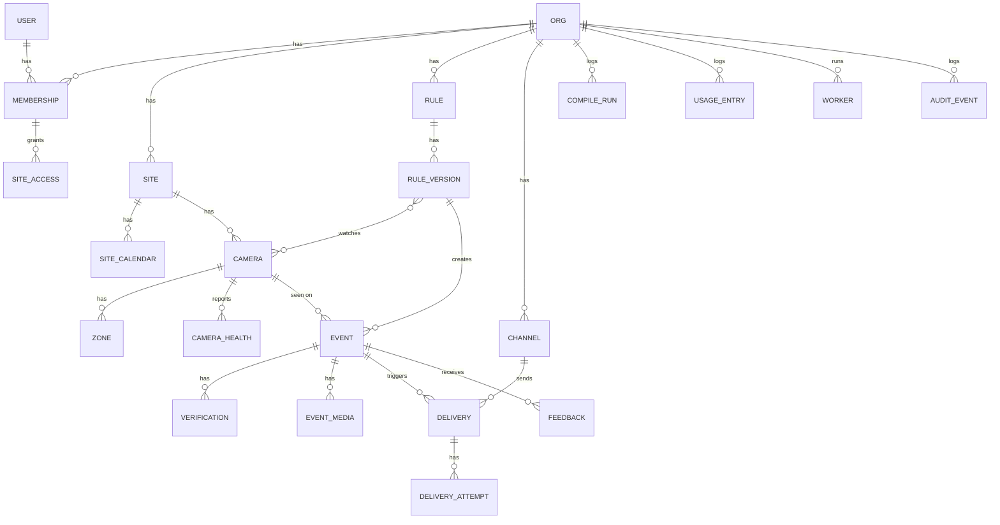

# 11 · Data Model

PostgreSQL. All business tables carry `org_id` and are queried through an org-scoped manager (same pattern as WatchOnce and InvoiceFlow); site-scoped tables also carry `site_id` and are filtered by the user's site access. IDs are prefixed strings (`cam_…`, `evt_…`) for readable logs and URLs. Times are `timestamptz` in UTC.

## Tables

### Tenancy and users
| Table | Key columns |
|---|---|
| `org` | `id`, `name`, `tier` (`home`, `school`, `business`), `settings` JSONB (retention, budgets, default channels), `created_at` |
| `user` | Django user + `display_name`, `timezone` |
| `membership` | `org_id`, `user_id`, `role` (`owner`, `admin`, `operator`, `viewer`), `all_sites` bool |
| `site_access` | `membership_id`, `site_id` (used when `all_sites` is false) |
| `api_token` | `org_id`, `name`, `hash`, `scopes`, `last_used_at`, `revoked_at` |

### Sites and cameras
| Table | Key columns |
|---|---|
| `site` | `id`, `org_id`, `name`, `timezone`, `address` (optional), `retention_days_media` (14), `retention_days_events` (90) |
| `site_calendar` | `site_id`, `kind` (`school_hours`, `business_hours`), `weekly` JSONB (`{mon: [["08:00","14:00"]], …}`), `holidays` date[] |
| `camera` | `id`, `org_id`, `site_id`, `name`, `rtsp_main_enc`, `rtsp_sub_enc` (Fernet), `stream_meta` JSONB (codec, resolution, fps), `detect_fps` (5), `cloud_ai_allowed` bool (false), `enabled`, `worker_id`, `snapshot_key` |
| `camera_health` | `camera_id`, `ts`, `state` (`online`, `reconnecting`, `offline`), `decode_fps`, `detect_fps`, `lag_ms`, `error`. Kept 7 days; latest also cached in Redis |
| `zone` | `id`, `camera_id`, `name`, `kind` (`polygon`, `line`), `points` JSONB (normalised `[[x,y],…]`), `in_side` (lines: `left`/`right` of the drawn direction), `color` |

### Rules
| Table | Key columns |
|---|---|
| `rule` | `id`, `org_id`, `site_id`, `name`, `status` (`draft`, `active`, `paused`, `archived`), `current_version_id`, `created_by` |
| `rule_version` | `id`, `rule_id`, `version` int, `source_text`, `spec` JSONB (validated `RuleSpec`), `spec_version`, `summary`, `assumptions` text[], `compile_run_id`, `created_by`, `created_at` |
| `rule_version_camera` | `rule_version_id`, `camera_id` (denormalised from the spec for fast "rules for this camera") |
| `compile_run` | `id`, `org_id`, `source_text`, `context_hash`, `prompt_version`, `provider`, `model`, `result_kind` (`rule`, `question`, `unsupported`, `invalid`), `raw_output` JSONB, `validation_errors`, `tokens_in`, `tokens_out`, `cost_usd`, `latency_ms` |
| `rule_test_run` | `rule_version_id`, `source` (`buffer`, `upload`), `media_key`, `results` JSONB (moments that would fire) |

### Events
| Table | Key columns |
|---|---|
| `event` | `id`, `org_id`, `site_id`, `camera_id`, `rule_version_id`, `track_id`, `idempotency_key` (unique), `state`, `severity`, `t_start`, `t_end`, `close_reason`, `reason` text, `objects` JSONB, `zones` text[], `peak_count`, `incident_id` (grouping), `created_at` |
| `verification` | `id`, `event_id`, `attempt`, `scope`, `question`, `image_key`, `image_phash`, `answer`, `confidence`, `reason`, `visibility`, `provider`, `model`, `cache_hit` bool, `latency_ms`, `cost_usd` |
| `event_media` | `event_id`, `kind` (`snapshot`, `clip`, `poster`, `crop`), `key`, `bytes`, `duration_ms`, `expires_at` |
| `feedback` | `event_id`, `user_id`, `verdict` (`confirmed`, `false_alarm`), `reason_code`, `note`, `created_at` |
| `event_comment` | `event_id`, `user_id`, `body`, `created_at` |

Indexes: `event (org_id, site_id, t_start desc)`, `event (camera_id, t_start desc)`, partial `event (rule_version_id) where t_end is null` (open events), `verification (image_phash)` for cache lookups.

### Actions
| Table | Key columns |
|---|---|
| `channel` | `id`, `org_id`, `kind` (`telegram`, `email`, `slack`, `webhook`), `name`, `config_enc` (Fernet JSON), `quiet_hours` JSONB, `enabled` |
| `telegram_link` | `channel_id`, `user_id`, `chat_id`, `linked_at`, `link_code` (one-time) |
| `delivery` | `id`, `event_id`, `channel_id`, `kind` (`alert`, `clip`, `digest`, `system`), `status` (`pending`, `sent`, `failed`, `suppressed`), `external_id` (Telegram message id, for replies) |
| `delivery_attempt` | `delivery_id`, `n`, `status_code`, `error`, `latency_ms`, `at` |

### Workers, usage, audit
| Table | Key columns |
|---|---|
| `worker` | `id`, `org_id`, `name`, `token_hash`, `version`, `host_info` JSONB, `last_seen_at`, `cameras` (assigned) |
| `usage_entry` | `org_id`, `camera_id`, `rule_version_id`, `event_id`, `purpose` (`compile`, `verify`), `provider`, `model`, `tokens_in`, `tokens_out`, `image_count`, `cost_usd`, `at` |
| `budget` | `org_id`, `camera_id` (nullable = org-wide), `period` (`day`, `month`), `limit_usd`, `warn_pct` (80) |
| `audit_event` | `org_id`, `actor` (user / worker / system), `action`, `target_type`, `target_id`, `before` JSONB, `after` JSONB, `ip`, `at`. Append-only: no update/delete grants for the app DB role |

## Retention (celery beat, hourly)

| Data | Default | Notes |
|---|---|---|
| Clips, snapshots, crops | 14 days per site | S3 objects deleted, `event_media` rows kept with `deleted_at` |
| Events (non-dismissed) | 90 days | Configurable up to 365 |
| Dismissed events | 7 days | Kept short; useful only for tuning |
| `camera_health` | 7 days | |
| Usage, audit | 13 months | For billing and audits |
| Rolling segment buffer | 2 minutes | On the worker's disk, never in S3 |

## Redis keys

| Key | Use |
|---|---|
| `cfg:worker:<id>` | Cameras + active rule specs for a worker (JSON); bumped `cfg:version:<id>` |
| `chan:worker:<id>` | Pub/sub: config changed, verify results |
| `health:cam:<id>` | Latest health (TTL 60 s) |
| `sse:org:<id>` | Pub/sub for dashboard events |
| `vcache:<rule_version>:<track>:<phash>` | Verification cache (TTL 10 s) |
| `budget:<org>:<day>` / `budget:<cam>:<day>` | Running cost counters |
