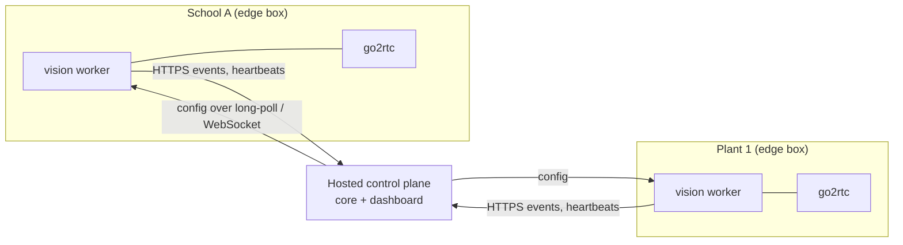

# 17 · Deployment & Ops

Three ways to run CamMind, all from the same images.

## 1 · Local development (Windows laptop)

```bash
# infra
docker compose -f infra/docker-compose.yml --profile test-streams up -d

# core
cd services/core
uv sync
uv run python manage.py migrate
uv run python manage.py seed_demo          # demo org, site, test cameras, zones, sample rules
uv run uvicorn config.asgi:application --port 8200 --reload
uv run celery -A config worker -Q compile,verify,media,actions --pool=solo -l info
uv run celery -A config beat -l info

# vision worker
cd services/vision
uv sync
uv run python -m cammind_vision run --worker-token $CAMMIND_WORKER_TOKEN --core http://localhost:8200

# dashboard
cd apps/web
pnpm install
pnpm dev --port 3200
```

`make dev` starts all of these with one command (honcho / `Procfile.dev`).

**FFmpeg:** PyAV wheels bundle it for decoding; the segment recorder needs the `ffmpeg` CLI on PATH (`winget install Gyan.FFmpeg` on Windows; included in the Docker images).

**Memory:** about 2–3 GB total with 4 test cameras. Stop WatchOnce and InvoiceFlow containers when working on CamMind.

## 2 · On-site box (home, school, office, factory)

A single machine on the same network as the cameras: a mini PC (Intel N100 or better), an old desktop, or a PC with a GPU for more cameras.

```bash
git clone https://github.com/<user>/cammind && cd cammind
cp .env.example .env              # set secrets, AI key, site time zone
docker compose -f infra/docker-compose.prod.yml up -d
```

`docker-compose.prod.yml` runs: Postgres, Redis, SeaweedFS (or local disk for media), go2rtc, core (gunicorn + uvicorn workers), Celery worker + beat, vision worker, dashboard (Next.js standalone), and **Caddy** for HTTPS on the LAN.

- **GPU:** `docker-compose.gpu.yml` override for NVIDIA (CUDA ONNX Runtime image). On Windows hosts, run the vision worker outside Docker to use DirectML.
- **Remote access (optional):** don't open ports on the router. Use Tailscale or a Cloudflare Tunnel to reach the dashboard from a phone. Alerts work without remote access because they're sent outbound.
- **Updates:** `docker compose pull && docker compose up -d`; migrations run on core start-up.
- **Backups:** nightly `pg_dump` to the media volume; clips are short-lived by design and not backed up.

## 3 · Hosted read-only demo (portfolio)

Real cameras can't be public, so the public demo runs on recorded data:

- Dashboard on **Vercel**, core on a small VPS or Fly.io, media on **Cloudflare R2**.
- `DEMO_MODE=true`: test-stream cameras only, seeded events with real clips from the evals, compiler live (with a strict rate limit and cheap model), verification on the recorded provider, notifications disabled except in-app.
- Visitors can type rules and see compiled specs, browse events and clips, and watch looped "live" streams with overlays.

## Multi-site (v0.3, designed now)



- The worker ↔ core boundary is already HTTP + tokens ([12](12-api-spec.md#internal-vision-worker--core)), so edge boxes only need outbound HTTPS.
- Clips upload from the edge to object storage with pre-signed URLs; live view goes peer-to-peer over WebRTC with a TURN server, or through Tailscale.
- Redis pub/sub for config is replaced by long-poll or WebSocket for remote workers.

## Monitoring

| Signal | Where |
|---|---|
| Worker metrics: fps, detector latency, queue depth, reconnects, outbox size | Prometheus endpoint on `:9300`; a simple Grafana dashboard JSON in `infra/grafana/` (optional) |
| Camera health | Dashboard + system notifications ([10](10-actions-and-notifications.md#system-notifications)) |
| Celery queue lengths, task failures | Flower (dev); logs + alerts on failure rate (prod) |
| Errors | Sentry (free tier) for core, worker and dashboard |
| AI spend | Usage page + budget alerts |
| Logs | JSON logs; event IDs and request IDs in every line; secrets masked |

## Runbook (common issues)

| Symptom | Likely cause | Fix |
|---|---|---|
| Camera shows `auth_failed` | Password changed or special characters not URL-encoded | Re-enter; CamMind encodes the password field separately |
| Camera keeps reconnecting | Camera limits connections; NVR also pulling | go2rtc should be the only client; point the NVR at go2rtc's restream |
| Live view black, detection works | H.265 not supported by the browser | Enable preview transcoding for that camera, or switch the camera's sub stream to H.264 |
| Detection fps drops | CPU overloaded | Lower fps on quiet cameras; GPU; smaller model |
| Events late by many seconds | Worker lagging (check `lag_ms`) or core down (outbox growing) | See health; restart core; check the network |
| Alerts but no clips | Recorder not running or main stream path wrong | Check the recorder logs; use sub stream for clips |
| Many false alarms at night | IR noise, insects near the IR LEDs, headlights | Raise `hold_seconds` and `min_box_px`; zone away from the lens; feedback suggestions |
